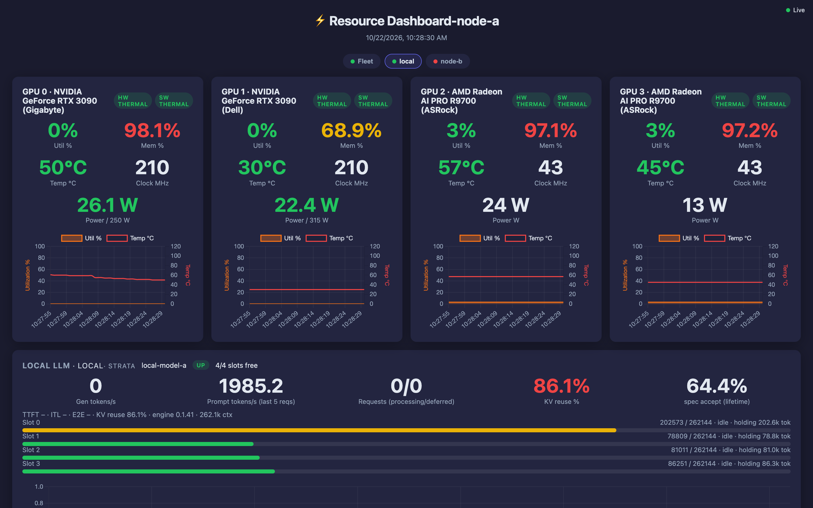
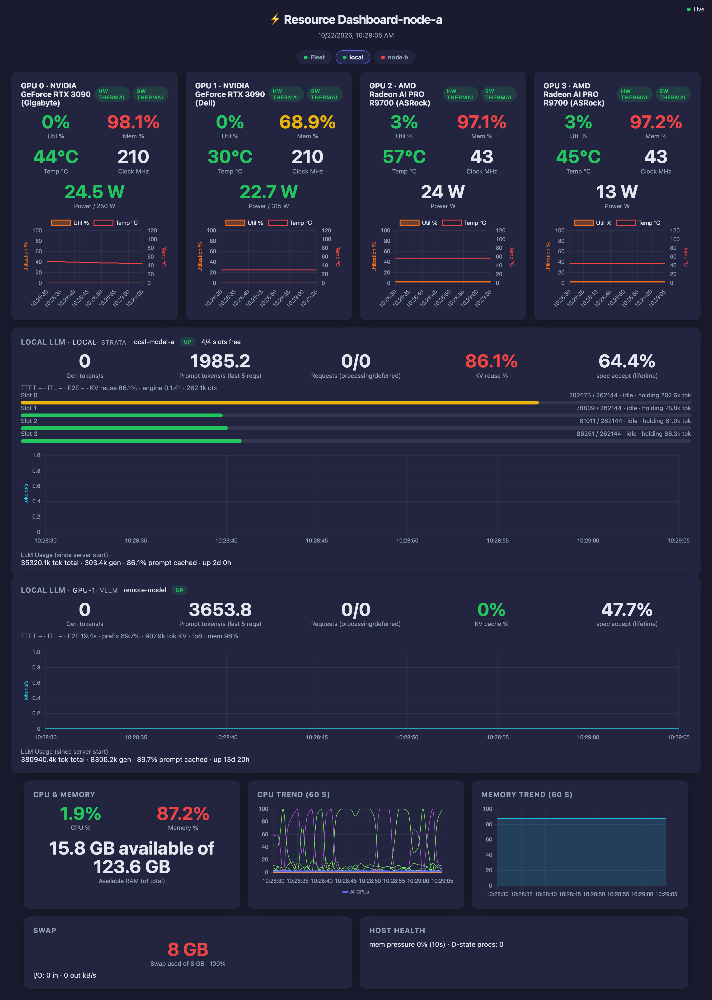

# Resource & GPU Utilization Dashboard

A lightweight, real-time web dashboard for a machine (or a small fleet of them): CPU load,
memory and swap, per-GPU utilization / memory / temperature / clock / power for **NVIDIA,
AMD and JetPack** boards, and live throughput for local **LLM inference servers**
(**llama.cpp, vLLM, LiteLLM, Strata**) — served by one small Flask app, updated over
Server-Sent Events, no database, no agent, no external services.

**Why it exists:** the inference boxes in a homelab or research LAN each run a different
serving stack on a different port, and the vendor tools (`nvidia-smi`, `amd-smi`,
`tegrastats`, `/metrics`) all speak a different dialect. This normalizes all of it into one
payload and one page, and then lets one dashboard aggregate the others so a whole fleet is
readable from a single tab row.

<p align="center">
  
</p>

## Features

- **CPU** — overall and per-core utilization with a live trend chart.
- **Memory** — usage %, used/total GB, swap usage and swap I/O rate, plus host health (PSI
  memory pressure, D-state process count).
- **GPU** (per card) — utilization % and memory % gauges + trend charts, temperature, clock,
  power draw, thermal-throttle badges. NVIDIA via `pynvml` → `nvidia-smi`; AMD via
  `amd-smi` → `rocm-smi` → sysfs; JetPack via sysfs.
- **LLM** (any number of servers at once) — generation & prompt tokens/s, requests in
  flight, KV cache / context usage, latency (TTFT/ITL/E2E), spec-decode accept rate,
  prefix-cache hit %, loaded model name. Backend auto-detected, or pinned; one card per
  target with parallel scraping.
- **Fleet** — one dashboard aggregates any number of others (relay model: each host keeps
  collecting locally, the aggregator polls `/api/metrics`).
- **Real-time** — Server-Sent Events; the browser's native `EventSource` reconnects on its
  own. No polling, no refresh.

## Screenshots

The full page on a mixed-vendor box — four GPU cards (NVIDIA via NVML, AMD via `amd-smi`),
two LLM targets scraped in parallel, CPU/memory trends, swap and host health:



Hostnames and model names in these images are placeholders (`node-a`, `node-b`,
`local-model-a`, `remote-model`) — capture your own with `scripts/capture_screenshots.sh`
if you want pictures of your own hardware.

## Quick start

```bash
git clone <your-fork-url> resource_dashboard
cd resource_dashboard
python3 -m venv .venv
source .venv/bin/activate            # Windows: .venv\Scripts\activate
pip install -r requirements.txt
python app.py                        # binds 0.0.0.0:5000
```

Open **http://localhost:5000**. No GPU, no LLM server and no `config.yaml` is fine — those
sections simply render as unavailable.

```bash
cp config.example.yaml config.yaml   # optional; auto-detected from the working directory
python app.py --host 127.0.0.1       # local-only instead of network-bound
python app.py --vllm-url http://192.168.1.10:8000 --llm-backend vllm
python app.py --no-llama             # hide the LLM section entirely
python app.py --default-view fleet   # open on the Fleet tab
```

## Prerequisites

- **Python 3.10+** (CI runs 3.12).
- **GPU metrics (optional)** — NVIDIA drivers with `nvidia-smi`, and/or AMD ROCm
  (`amd-smi` ships with ROCm 6.x+; `rocm-smi` and plain sysfs also work), or a JetPack board
  (Orin/Thor — nothing to install). Works with no GPU at all.
- **LLM metrics (optional)** — a reachable inference server. llama.cpp needs
  `llama-server --metrics`; LiteLLM needs the `prometheus` callback.

## Configuration in one screen

Precedence: **env > CLI > `config.yaml` > defaults**. A `config.yaml` in the working
directory is auto-detected; `--config PATH` is explicit (and exits if the file is missing).

```yaml
port: 5001
poll_interval: 1.0
llm_backend: litellm              # auto | llama | vllm | litellm | strata
litellm_url: http://127.0.0.1:4000
litellm_token: sk-...             # or RD_LITELLM_TOKEN, which wins over everything
default_view: local               # local | fleet
upstreams:
  - name: node-a
    url: http://node-a.example.com:5001
```

Full key/flag reference, `llms:` multi-target rules and `upstreams:` semantics:
[documentation/configuration.md](documentation/configuration.md).

## Documentation

| Document | Read it for |
|---|---|
| [configuration.md](documentation/configuration.md) | Every config key and CLI flag, env vars, multi-LLM (`llms:`), upstreams |
| [deployment.md](documentation/deployment.md) | systemd unit + `install_service.sh`, production WSGI, security posture, fleet rollout order |
| [gpu-detection.md](documentation/gpu-detection.md) | NVIDIA/AMD/JetPack detection chains, `amd-smi`/`rocm-smi` output contracts and units, JetPack smoke script |
| [llm-backends.md](documentation/llm-backends.md) | What each backend exposes and how every metric is derived |
| [api.md](documentation/api.md) | `/`, `/events`, `/api/metrics`, `/health` — payload keys and shape history |
| [architecture.md](documentation/architecture.md) | Threads and cadence, SSE broadcast hub, stale-hold/busy-latch, fleet relay model, limitations |
| [troubleshooting.md](documentation/troubleshooting.md) | Symptom → cause → fix, log behaviour, `/health` triage |

## API at a glance

```bash
curl http://127.0.0.1:5000/api/metrics | python -m json.tool   # one-shot snapshot
curl http://127.0.0.1:5000/health      | python -m json.tool   # self-observability
```

`GET /events` streams the same payload as SSE. Details and payload shape:
[api.md](documentation/api.md).

## Security

**There is no authentication and the default bind is `0.0.0.0`.** Anyone who can route to
the port can read your hostnames, model names and traffic rates. Keep it on a trusted
network or front it with an authenticating reverse proxy; use `--host 127.0.0.1` when
local-only is enough. `RD_LITELLM_TOKEN` is the only credential the app handles.
See [deployment.md](documentation/deployment.md#security-posture--read-first).

## Project structure

```
resource_dashboard/
├── app.py                    # settings, collection loop, Flask routes, SSE hub, fleet layer
├── collectors/
│   ├── base.py               # BaseLLMCollector — shared per-target state + stale-hold
│   ├── gpu.py                # NVIDIA / AMD / JetPack collectors + merge
│   └── llm.py                # llama.cpp / vLLM / LiteLLM / Strata collectors
├── templates/index.html      # dashboard UI (Chart.js, gauges, tabs)
├── static/chart.umd.min.js   # vendored Chart.js (MIT) — no CDN
├── tests/test_metrics.py     # unit tests for the collectors and settings
├── documentation/            # the docs table above
├── config.example.yaml       # annotated example (copy to config.yaml — gitignored)
├── install_service.sh        # renders + installs the systemd unit
├── resource-dashboard.service
├── requirements.txt          # pinned runtime deps (flask, psutil, nvidia-ml-py, PyYAML, waitress)
└── pyproject.toml            # ruff / mypy / pytest config + project metadata
```

Runtime state that is deliberately **not** tracked: `config.yaml`,
`.llama_usage_state*.json` (llama.cpp usage counters), caches, `docs/` (working notes).

## Development

```bash
python -m pip install -r requirements.txt pytest ruff mypy
pytest tests/ -v                          # unit tests
ruff check app.py collectors tests/       # lint
mypy app.py                               # types (baseline-gated, see CI)
```

[GitHub Actions](.github/workflows/ci.yml) runs ruff, a baseline-capped mypy pass and pytest
on every push and pull request.

### Regenerating the screenshots

```bash
scripts/capture_screenshots.sh --url http://your-host:5000 \
  --redact "yourhost=node-a,peer=node-b,YourModelName=local-model-a"
```

It serves the live dashboard through a redacting proxy (page HTML, `/api/metrics` and the
SSE frames), waits for real trend history, captures the Local view and the full page, and
**refuses to write** if any string you asked to redact is still visible in the rendered DOM.

## Contributing

Issues and pull requests are welcome. For behaviour changes, open an issue first — payload
keys and the fleet compatibility rules in [api.md](documentation/api.md) are the contract
other deployments depend on. Please run `pytest` and `ruff check` locally, and redact
hostnames and tokens from anything you paste.

## License

MIT — see [LICENSE](LICENSE). Vendored: Chart.js (MIT, `static/chart.umd.min.js`).
